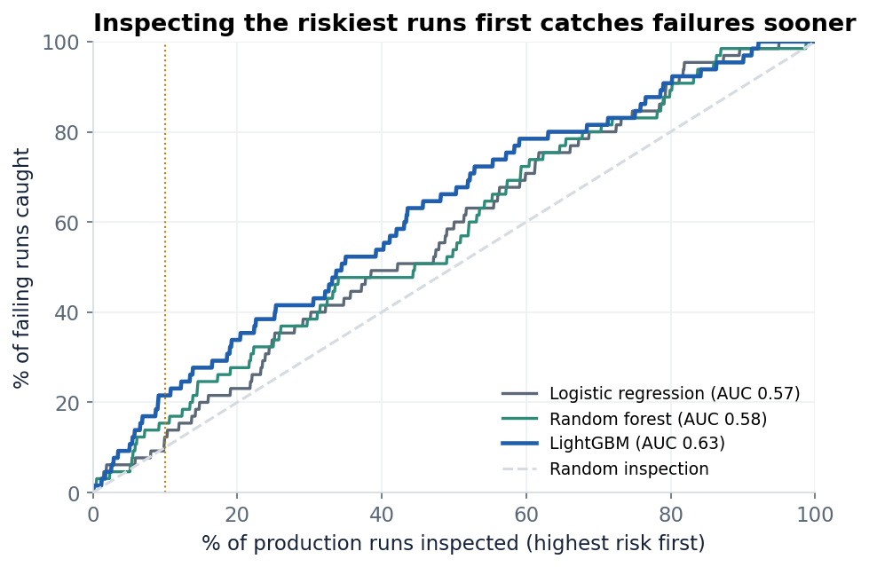
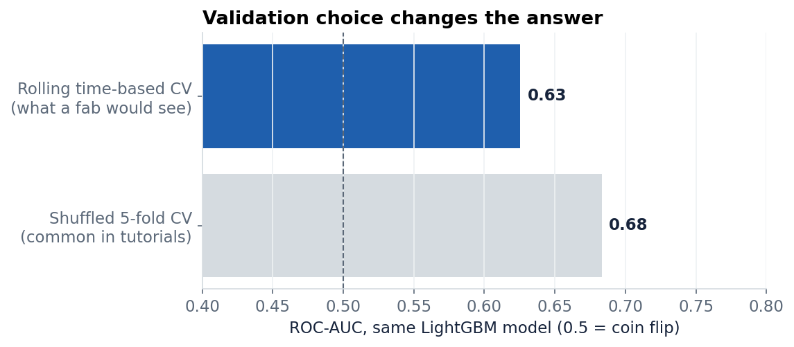
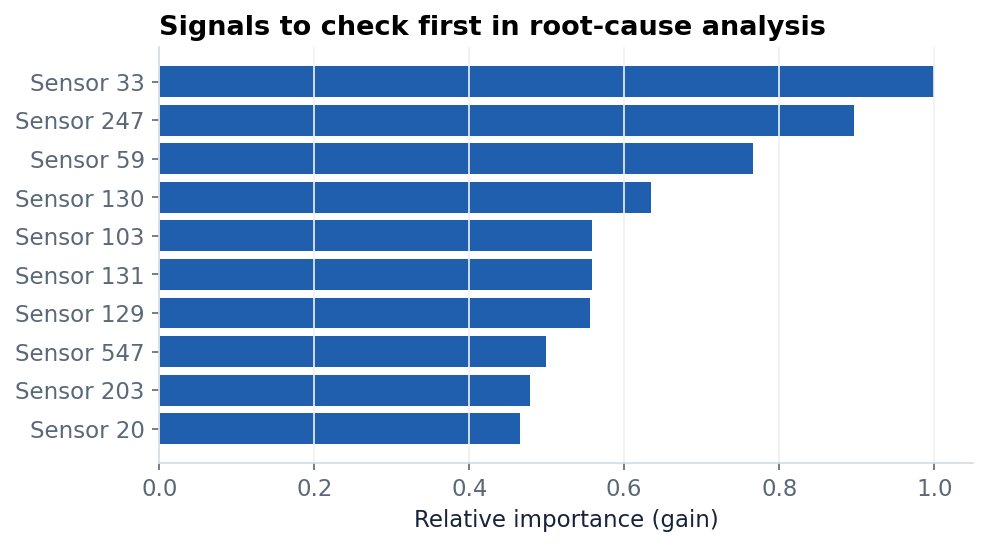

# Which production runs will fail? Predicting semiconductor failures from 590 sensors

A semiconductor line logs 590 sensor signals for every production run, and about 1 in 15 runs fails inspection. This project tests how well those signals can rank runs by failure risk, **validated the way a factory would actually use the model**: train on past runs, predict the next ones.

**Case study:** https://yadnesh-baste.github.io/projects/secom.html

## Key results

| Model | ROC-AUC | Failures caught when inspecting the riskiest 10% | 20% | 30% |
|---|---:|---:|---:|---:|
| Logistic regression (baseline) | 0.57 | 12% | 23% | 38% |
| Random forest | 0.58 | 15% | 28% | 38% |
| **LightGBM** | **0.63** | **22%** | **34%** | **42%** |

Evaluated with rolling time-based cross-validation on 1,305 runs (65 failures). Random inspection catches 10% at 10% effort, so LightGBM roughly doubles the hit rate. The 90% bootstrap interval for its AUC is 0.57 to 0.68: a useful prioritisation aid, not an automatic reject rule.



## Why the validation matters

Only 6.6% of runs fail, so a "model" that passes everything is 93% accurate. Many published notebooks also shuffle runs before splitting, which lets the model learn from the future. The same LightGBM pipeline scores AUC 0.68 with a shuffled split but 0.63 with a time-ordered one. The second number is the one a factory would see.



## Method

1. **Data repair.** The common CSV copy of SECOM has day and month swapped whenever the day is 12 or less. Dates are repaired; runs stay in production order.
2. **Cleaning inside the pipeline** (so nothing leaks from test data): drop sensors more than 50% empty, median imputation, drop constant sensors, drop near-duplicates (|r| > 0.95). 590 signals become 273.
3. **Models:** L2 logistic regression, random forest and LightGBM, all class-weighted for the rare failures.
4. **Evaluation:** `TimeSeriesSplit(5)`; metrics are ROC-AUC, PR-AUC and recall at a fixed inspection budget.



## Run it

```bash
pip install -r requirements.txt
python get_data.py          # downloads SECOM (UCI, CC BY 4.0)
python analysis.py          # trains and evaluates, writes results.json
python naive_vs_honest.py   # accuracy trap and shuffled-split comparison
python make_figures.py      # redraws the figures
```

## Limitations and next steps

- The public data has no failure reasons and no process context (tool, chamber, recipe), which limits what any model can learn.
- Next: monitor score drift week by week, set a cost-based threshold once inspection and scrap costs are known, and compare against simple per-sensor control limits.

## Data

McCann, M. and Johnston, A. (2008). SECOM. UCI Machine Learning Repository. https://doi.org/10.24432/C54305 (CC BY 4.0)

---
Yadnesh Baste · [Portfolio](https://yadnesh-baste.github.io) · [LinkedIn](https://www.linkedin.com/in/yadneshbaste)
